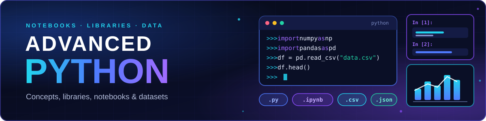

<p align="center">
  
</p>

<p align="center">
  <i>A visual collection of Python concepts, libraries, notebooks, datasets and hands-on practice.</i>
</p>

<p align="center">
  <a href="https://github.com/Pankaj-Jhajhria/Advanced_Python">
    
  </a>
</p>

<p align="center"></p>

<h2 align="center">🗺️ Learning map</h2>


<p align="center"></p>

<h2 align="center">🧩 Topic cards</h2>

| 🐍 **Python Fundamentals** | 🌐 **APIs & File Handling** |
|:---|:---|
| Variables, strings, lists, dictionaries, sets, functions and modules.<br>[Basics](1_a.py) · [Strings](2_String.py) · [Lists](3_Lists.py) · [Dicts](4_Dictionary.py) · [Sets](5_Sets.py) · [Functions](6_Functions.py) · [Modules](7_Modules.py) | REST calls with `requests`, plus JSON, binary files, images and pickle.<br>[8 · API](8_API.ipynb) · [9.2 · File Handling](9.2_File_Handling.ipynb) |

| 🧱 **Object-Oriented Programming** | 🛡️ **Error Handling** |
|:---|:---|
| Classes and objects, encapsulation and abstraction.<br>[9.3 · OOP](9.3_Oops.ipynb) | Handling errors, reading stack traces and writing custom exceptions.<br>[9.1 · Error Handling](9.1_Error_Handling.ipynb) |

| 🔁 **Iterators & Generators** | 🎯 **Namespaces & Decorators** |
|:---|:---|
| Iterables, iterators, `yield` and generator expressions.<br>[9.5 · Iterators](9.5_Iteratable_Iterators.ipynb) · [9.6 · Generators](9.6_Generators.ipynb) | Scope, the LEGB rule, built-in and enclosing scope, and decorators.<br>[9.4 · Namespaces & Decorators](9.4_NameSpaces_Decorators.ipynb) |

<p align="center"></p>

<h2 align="center">🎬 Hands-on notebooks</h2>

<p align="center"><sub>Pandas-based dataset exploration in notebooks — not deployed apps.</sub></p>

| 🎬 **Movie Recommend** | 📚 **Book Recommendion** |
|:---|:---|
| Explores movie datasets: ranks titles by votes, cleans the vote counts and filters Indian movies by language and genre.<br>`pandas` · `NumPy`<br>**[Open notebook ↗](Libraries/Movie_Recommend.ipynb)** | A starter notebook that loads the books dataset, inspects its columns and sorts titles by price.<br>`pandas` · `NumPy`<br>**[Open notebook ↗](Libraries/Book_Recommendion.ipynb)** |

<p align="center"></p>

<h2 align="center">📚 Python libraries</h2>

| 🔢 **NumPy** | 🐼 **pandas** | 📈 **Matplotlib** | 🌐 **Requests** | 🖼️ **Pillow** |
|:---:|:---:|:---:|:---:|:---:|
| Arrays & math<br>[notebook](Libraries/1_Numpy.ipynb) | Tables & analysis<br>[notebook](Libraries/2_Pandas.ipynb) | Plotting<br>[in NumPy notebook](Libraries/1_Numpy.ipynb) | API calls<br>[notebook](8_API.ipynb) | Image handling<br>[notebook](9.2_File_Handling.ipynb) |

<p align="center"></p>

<h2 align="center">🗂️ Dataset gallery</h2>

| 🎬 **Movies** | 📚 **Books** |
|:---|:---|
| [movies_data.csv](data/CSV_Datasets/movies_data.csv) · [indian movies.csv](data/CSV_Datasets/indian%20movies.csv) · [IMDB_10000.csv](data/CSV_Datasets/IMDB_10000.csv) · [Bollywood/](data/CSV_Datasets/Bollywood) | [BooksDatasetClean.csv](data/CSV_Datasets/BooksDatasetClean.csv) · [books.csv](data/CSV_Datasets/books.csv)<br><sub>Large files (60–80 MB)</sub> |

| 🏏 **Cricket & YouTube** | 🧾 **Small files & images** |
|:---|:---|
| [Virat Kohli DataSet.csv](data/CSV_Datasets/Virat%20Kohli%20DataSet.csv) · [youtube_top_india_by_subscribers.csv](data/CSV_Datasets/youtube_top_india_by_subscribers.csv) | [demo.json](data/demo.json) · [file2.json](data/file2.json) · [file.txt](data/file.txt) · [person.pkl](data/person.pkl) · [new.png](data/new.png) |

<p align="center"></p>

<h2 align="center">🧭 Repository explorer</h2>

```text
Advanced_Python/
├── 1_a.py … 7_Modules.py                    # fundamentals scripts
├── 8_API.ipynb
├── 9.1_Error_Handling.ipynb … 9.6_Generators.ipynb
├── Libraries/                               # NumPy, pandas, movie & book notebooks
├── Other_Stuff/                             # shortcuts, diagram, PDF notes
└── data/
    ├── CSV_Datasets/                        # movies, books, cricket, YouTube
    └── demo.json, file.txt, person.pkl …    # file-handling samples
```

<p align="center"><sub>Jump to: <a href="Libraries"><code>Libraries/</code></a> · <a href="data"><code>data/</code></a> · <a href="data/CSV_Datasets"><code>CSV_Datasets/</code></a> · <a href="Other_Stuff"><code>Other_Stuff/</code></a></sub></p>

<p align="center"></p>

<p align="center">
  Pick a topic, open a notebook and run the cells.<br>
  <a href="https://github.com/Pankaj-Jhajhria/Advanced_Python">github.com/Pankaj-Jhajhria/Advanced_Python</a> · Built by <b>Pankaj</b>
</p>
